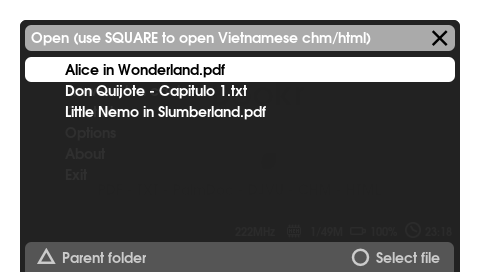
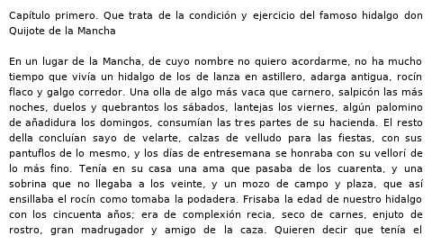
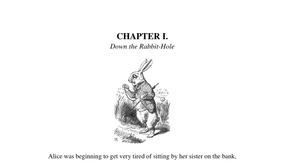
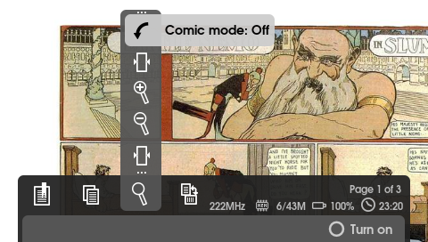
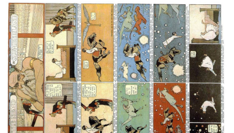

# Bookr Plus

A PDF and e-book reader for the Sony PSP, based on **Bookr V8.1**. Bookr Plus
makes the 2009 source build with today's PSP toolchain and adds a handful of
reading improvements: smooth panning and zoom, margin trimming for scanned
comics, a right-to-left comic mode, UTF-8 text files, zoom for text files,
screenshots saved to the Memory Stick, a neobrutalist interface, and use of
the PSP-2000/3000's extra memory.

It has been tested on a **PSP-3000 running ARK-4 custom firmware**.

Bookr reads plain text, PDF, CHM, HTML, DjVu and PalmDoc/Mobipocket (without
DRM). The original V8.1 readme is kept in
[README.original.md](README.original.md).

## Screenshots

| | |
| --- | --- |
|  |  |
| The file browser | A UTF-8 text file in Spanish, accents included |
|  |  |
| A PDF page at fit width | A colour comic, with the zoom menu's new **Trim margins** and **Comic mode** items |
|  | |
| Comic mode: the page is turned for holding the PSP upright, D-pad on top, and opens at its top-right corner | |

These were taken in the [PPSSPP](https://www.ppsspp.org/) emulator running the
same `EBOOT.PBP`, so the memory counter shows the emulator's memory, a little
more than a real PSP-3000 has. The file browser and zoom menu shots still show
the grey interface from before the [neobrutalist restyle](#neobrutalist-interface). The books are public domain: *Don Quijote*
(Cervantes), *Alice's Adventures in Wonderland* (Lewis Carroll, illustrated by
John Tenniel) and *Little Nemo in Slumberland* (Winsor McCay, 1905).

## What's new compared to Bookr V8.1

### Builds with the current PSP toolchain

The V8.1 source last compiled with a 2009 Windows/Cygwin setup. It now builds
on macOS (and should on Linux) with the [pspdev](https://github.com/pspdev/pspdev)
toolchain (tested with release v20261001, GCC 15.2). The changes needed were:

| Area | Change |
| --- | --- |
| Makefiles | Hardcoded `/usr/local/pspdev` and `c:/pspsdk` FreeType paths replaced with `psp-config --psp-prefix`; Windows `\` paths in object lists fixed; links `-lbz2`, which current FreeType needs |
| MuPDF (`pdf_font.c`) | Used FreeType's private `ftobjs.h` header to read the font driver name; now uses the public `FT_Get_Font_Format()` |
| MuPDF (`xref.h`) | Missing declaration for `pdf_uncacheobject()`, an error since GCC 14 |
| DjVuLibre | Built as C++98 with `-fpermissive` and `stddef.h` included, as the 2007 code expects |
| App | Built as C++98 (old narrowing in Vietnamese tables); `stricmp` mapped to `strcasecmp`; `pspTime` renamed to `ScePspDateTime` in the SDK; `printf` redirect declared after `stdio.h` |
| `djvu/Makefile` | Creates its `libs` folder, which git does not track |

A [`build.sh`](build.sh) script builds everything in the right order.

### Uses the PSP-2000/3000 extra memory

The app is now built with `PSP_LARGE_MEMORY = 1` (the `MEMSIZE` flag), and
Bookr already asks for "all memory minus 7 MB". On a PSP-2000/3000 that gives
it about 45 MB instead of about 17 MB, which helps with large and image-heavy
PDFs. It is named **Bookr Plus** on the XMB so it can sit next to an original
Bookr.

### UTF-8 text files with accents

Bookr's text font holds 256 glyphs addressed by byte value, so `.txt` files
had to be Latin-1, and characters like `—` `“` `”` `…` could not be shown at
all.

- Glyph slots now follow **Windows-1252**: Latin-1 plus the dashes, curly
  quotes, ellipsis, `€` and a few others in slots 0x80–0x9F.
- Text files that are valid UTF-8 (or start with a UTF-8 BOM) are detected
  and converted to those slots when opened. Latin-1 files are never valid
  UTF-8, so they keep working unchanged.
- Common characters without a slot get a stand-in (`―` → `—`, `‐` → `-`,
  typographic spaces → space); zero-width characters and BOMs are dropped;
  anything else becomes `?`.

This covers Spanish, French, Portuguese, German, Italian and other
Western European languages.

### Zoom for text files

In V8.1, L / R did nothing in text files. The text size could only be changed
in the options menu, and changing it reloaded the whole file.

- **R / L** (the zoom in / zoom out buttons) make the text 1 px bigger or
  smaller per press, from 6 to 20 px. A "Text size 16 px" banner shows the new
  size.
- The text re-wraps in place, and the paragraph at the top of the screen stays
  there. The page count updates to match.
- The size is the same setting as **Options → Plain text - Font size**, so it
  is saved and the next text file opens at that size.
- The toolbar's zoom menu now has **Zoom out** and **Zoom in** for text files
  too; it used to say "No zoom support".
- PalmDoc/Mobipocket books use the same text engine, so they zoom too.

### Precise movement and zoom in PDFs

| Control | Bookr V8.1 | Bookr Plus |
| --- | --- | --- |
| D-pad | Jumps 250 px (up/down) or 460 px (left/right) | Moves **5 px** per press; hold to scroll smoothly |
| Analog stick | Up to 32 px per frame, slowed down by every page redraw | Timed in **pixels per second**: 15 px/s (light push) to 800 px/s (full tilt), on a curve that keeps small pushes precise. Same speed even while a slow page redraws |
| L / R zoom | Fixed steps (1.0, 1.1, … 2.0, 2.25, 2.5 …) | Page width grows or shrinks by **5 px** per press; hold to keep zooming |
| While zooming | Page re-rendered after every step | Only the "Zoom 1.27x" label updates; the page renders **once, on release** |
| After zooming | View jumped sideways (pan was multiplied by the absolute zoom) | View **stays centred** on the same spot |
| Bookmarks / last view | Saved the nearest zoom step | Save the **exact zoom** |

The step sizes are constants at the top of `Bookr/bkpdf.cpp` (`panStep`,
`analogMinSpeed`, `analogMaxSpeed`) and in `BKDocument::processEventsForView`
(zoom `step`).

For the smoothest stick movement, turn on **PDF - Fast images** in the options
menu. The page is then drawn once and moving is just copying memory, so it
scrolls at the full 60 fps. Without it, every move redraws the page, which is
slow for image-heavy PDFs such as comics. Bookr Plus now remembers this setting
between launches (V8.1 turned it off every time).

### Trim margins

Scanned books and comics often have white side margins that change from page
to page, typically wider on the left on odd pages and on the right on even
pages. A zoom and position that frame one page well are off on the next.

**SELECT → zoom menu → Trim margins: Off/On** hides the white space at the
left and right of every page:

- When a page opens, it is rendered small (400 px wide) and each column is
  checked for ink (pixels darker than 215). Columns need at least 3 ink
  pixels, so dust specks are ignored. A 1.5% safety margin is added on each
  side, so content is never cut.
- The page's media box is narrowed to that range in memory, like a crop box.
  The PDF file is not modified.
- The result is cached per page, so each page is analysed only once while the
  book is open.
- The zoom is kept **relative to the trimmed width**, so every page's content
  fills the screen the same way. Turning trim on starts at "fit width".
- While trim is on, turning the page **keeps the view position**, so a
  framing you set with the arrows and zoom carries over to the next page.
- The trim setting and zoom are saved with the book's last view.

### Comic mode

For reading manga and other right-to-left comics with the PSP held upright,
D-pad at the top.

**SELECT → zoom menu → Comic mode: Off/On** does three things:

- Turns the page **90° counterclockwise**, so the top of the page sits next to
  the D-pad and the bottom next to the ✕ ○ □ △ buttons.
- Turns **Trim margins** on, so the page's height fills the screen and the
  white side margins are gone.
- Opens every page at its **top-right corner**, where a right-to-left comic
  starts. This applies to next/previous page and to page jumps. Your zoom is
  kept.

Turning Comic mode off restores the rotation and trim setting it replaced.
Bookmarks and the last view remember Comic mode, and still open at the exact
saved position. The start corner is worked out from the page's rotation, so
it stays right if you rotate the page while Comic mode is on.

### Colour pages in image PDFs

Bookr's MuPDF refused to load any image needing more than 2 MB once
decoded, and silently drew a blank grey square instead. That limit protected
the PSP-1000, but it blanked every colour page of a scanned comic: an 800 ×
1202 RGB page needs 2.8 MB, while the same page in grayscale needs 0.9 MB.

Bookr Plus now loads an image whenever three times its decoded size (the
samples, plus the tile and scaled copy drawn from them) and 1 MB of headroom
fit in free memory at that moment (`bk_pdf_fitsinmemory()` in
`mupdf/mupdf/pdf_image.c`). Colour pages now show on a PSP-3000, and
on a PSP-1000 oversized images are still skipped rather than crashing. The
per-page image total was raised from 8 MB to 32 MB as a sanity cap.

The probe allocates and frees a block. Its pointer is `volatile`, because GCC
otherwise removes an unused `malloc`/`free` pair, which silently turns the
check into "always fits".

### Memory diagnostics

- **Toolbar memory counter:** the counter next to the clock and battery shows
  **used/free** in MB (for example `8/36M`) instead of only kilobytes used.
  "Free" is the largest block `malloc` can hand out, found by binary search,
  so it shows whether the PSP-2000/3000 extra memory is active.
- **No more silent blanks:** when an image is skipped for lack of memory, the
  page banner says so, for example "Page 1 of 222 - not enough memory for 1
  image", instead of showing an unexplained grey page.

If the free number stays under about 15 MB on a PSP-2000/3000, the custom
firmware is not granting the extra memory. On ARK-4 that is the `highmem`
setting in `SETTINGS.TXT`.

### Screenshots to the Memory Stick

**SELECT → camera menu → Screenshot** saves what is on the screen as a PNG:

- The toolbar closes first and the page is redrawn without banners or tips,
  so the picture shows only the page, exactly as you see it, including zoom,
  rotation and comic mode.
- Files go to `PICTURE/BookrPlus/` on the Memory Stick, named by date and
  time, for example `BookrPlus_20261028_234029.png`. Two shots in the same
  second get `_2`, `_3`. The PSP's **Photo** menu lists them.
- A green box in the middle of the screen says **Screenshot saved** with the
  file name, then fades out. If the file can't be created or written (Memory
  Stick full or locked), a red **Screenshot failed** box gives the reason
  instead.
- Each shot is 480 × 272, usually 30 to 400 KB.

The image is read from the frame buffer the display is showing
(`sceDisplayGetFrameBuf`) and written with libpng, which Bookr already links
for its textures (`FZScreen::saveScreenshot()` in `Bookr/fzscreenpsp.cpp`).
To make room for the fifth toolbar menu, the CPU speed moved up next to the
page number.

### Neobrutalist interface

Bookr Plus has its own look: flat bright colours, thick black outlines, hard
black shadows and square corners, in place of V8.1's translucent grey rounded
panels.

| Element | Look |
| --- | --- |
| Start screen | Cream background, a new logo (a yellow "Bookr" card with a tilted pink "PLUS" sticker) and a pink **Press Start** button |
| Menus and file browser | Cream panels, yellow title bar, cyan button bar, pink selection, black text |
| Toolbar | Cream bar; the open menu is a white column and the selected item a pink box |
| Icons | Black, with hard edges |
| Popups | Yellow title for warnings, cyan for information, red for errors |
| XMB icon | Matches the new logo, on a transparent background |

The colours you read in (**Color schemes**) are not affected. The palette is
the `NEO_*` constants in `Bookr/bklayer.h`, written as `0xAABBGGRR`, the byte
order the PSP's GPU uses, and every panel is drawn by `BKLayer::drawNeoBox()`.
The icons in `data/ui.png` and `data/ui2.png` are white and tinted when drawn,
so their colour is set in code.

### Bug fixes

- `recalcScreenMediaBox()` used the page's `x0` where it meant `y0`. It made
  no difference while every page started at (0, 0), but it would have
  misplaced trimmed pages and PDFs whose crop box does not start at the
  origin.
- The SELECT toolbar always showed **✕** next to "Select", "Turn on" and the
  other actions, even with the default Asian button style, where **○**
  selects. It now shows the button that actually selects, like the menus do.

## Controls

Default in-book controls (changeable in Bookr's menu):

| Button | Action |
| --- | --- |
| D-pad | Move 5 px (hold to scroll) |
| Analog stick | Move, speed depends on how far it is pushed |
| R / L | Zoom in / out (PDF: page width; text files: text size) |
| △ / □ | Next / previous page |
| ✕ / ○ | Forward / back 10 pages |
| SELECT | Toolbar: bookmarks, pages, zoom (fit height, fit width, zoom out, zoom in, **trim margins**, **comic mode**), rotation, **screenshot** |
| START | Main menu and options |

## Installing on a PSP

1. Build `EBOOT.PBP` (see below), or take it from a release.
2. Copy it to `PSP/GAME/BookrPlus/EBOOT.PBP` on the Memory Stick. Also copy
   `Bookr/WebVIQR.txt` there if you read Vietnamese HTML/CHM files.
3. Put your books anywhere on the Memory Stick; Bookr has its own file browser.

On macOS, Finder adds hidden `._` files when copying to the Memory Stick. Bookr
lists them as books, and in the `ISO` folder they can confuse the PSP's game
list. Remove them before ejecting:

```sh
dot_clean "/Volumes/NO NAME"
```

## Building from source

1. Install the [pspdev toolchain](https://github.com/pspdev/pspdev/releases)
   and put its `bin` folder on your `PATH`. On macOS, use the
   `pspdev-macos-latest-arm64` (Apple silicon) or `x86_64` (Intel) package.
2. Run:

   ```sh
   ./build.sh
   ```

   This builds the bundled MuPDF and DjVuLibre libraries, then the app, and
   writes `Bookr/EBOOT.PBP`.

After a library has been built once, `cd Bookr && make` rebuilds only the app.
The Makefiles do not track header dependencies, so after editing a header,
delete the app's `.o` files first.

## Tools for the Mac

Both tools live in [`tools/`](tools).

### `pdf2psp.swift`: make image PDFs readable in Bookr

Bookr's PDF engine dates from 2005 and cannot decode **JBIG2** or
**JPEG 2000** images. That is the "unknown filter: JBIG2Decode" error.
Internet Archive scans use both: each page is a JPEG 2000 background, a
JPEG 2000 ink colour layer, and a 1-bit JBIG2 mask holding the line art.

macOS can read those formats, so this tool redraws every page and stores it
as a plain JPEG, which Bookr handles. Black-and-white pages are stored as
grayscale, which makes them smaller and faster to decode on the PSP.

```sh
swiftc -O -o pdf2psp tools/pdf2psp.swift
./pdf2psp "input.pdf" "output.pdf" 800 0.6   # page width in px, JPEG quality
```

800 px wide at quality 0.6 kept screentones and lettering clean in testing
(about 225 KB per manga page).

### `sfo_memsize.py`: give an existing EBOOT the extra memory

Adds `MEMSIZE=1` (and optionally a new title) to an `EBOOT.PBP` without
recompiling it. The program data is copied unchanged.

```sh
python3 tools/sfo_memsize.py EBOOT.PBP EBOOT_new.PBP "My App 64MB"
```

This only helps if the program sizes its heap from available memory, as
Bookr does with `PSP_HEAP_SIZE_KB(-7*1024)`.

## Known limitations and ideas

- **JBIG2 / JPEG 2000 PDFs** still don't open on the PSP; convert them with
  `pdf2psp.swift`. MuPDF has dormant glue for both (`filt_jbig2d.c`,
  `filt_jpxd.c`). Enabling JBIG2 with jbig2dec is possible, but full-size
  JPEG 2000 layers would be slow and memory-hungry on the PSP.
- **Trim margins** keeps page numbers and other marks in the margin, so
  content can sit slightly off-centre. Ignoring small isolated marks near the
  edges would fix it.
- **Text files** support Western European characters only (Windows-1252).
  Other scripts would need a larger glyph atlas.
- **Text zoom** re-wraps the whole file at every step, so a very large `.txt`
  file can take a moment per press on the PSP.
- **Screenshots** are at screen resolution (480 × 272). Saving a whole PDF
  page at full resolution would need a separate export.
- **Fast images** mode is still limited to 2x zoom. The extra memory could
  raise that.
- **CBZ** comics (or image folders) and **EPUB** support are possible next
  steps. Comic mode already handles right-to-left reading for PDFs.

## Credits

- **Bookr**: Carlos Carrasco Martinez and Edward Choh (original); Christian
  Payeur (controls and GUI); Yang.Hu (DjVu); Nguyen Chi Tam (CHM/HTML,
  V8.0/V8.1). V8.1 source: <https://github.com/nguyenchitam/Bookr>
- **MuPDF**: Artifex Software, under the Aladdin Free Public License (see
  `Bookr/mupdf/PUBLIC`)
- **DjVuLibre** 3.5: Léon Bottou and Yann Le Cun
- **chmlib**: Jed Wing. **VnConv**: Pham Kim Long
- **pspdev**: the PSP homebrew toolchain and SDK

## License

Bookr and Bookr Plus are licensed under the **GNU General Public License
version 2 or later** (see [LICENSE](LICENSE)). The bundled libraries keep
their own licences: MuPDF under the Aladdin Free Public License, DjVuLibre
under the GPL, and chmlib under the LGPL.
